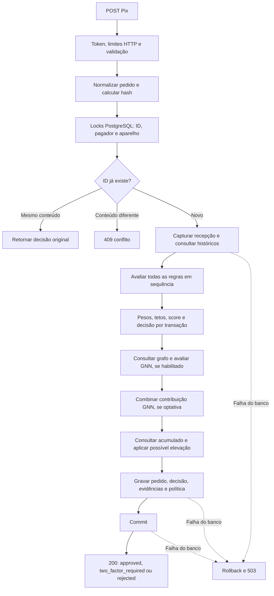

# Verificação de dados, regras e arquitetura antifraude

Verificação em **17/10/2026**, sobre o código da revisão `38d7f11` mais os testes
adicionados nesta auditoria. Política do repositório: **pix-score-v6**.
Este documento descreve o comportamento implementado, sem atestar eficácia contra
fraude real. Valores monetários são inteiros em centavos.

## Resultado comprovado

**301 testes passaram, zero falhas e zero ignorados**, em API e PostgreSQL isolados.
A revisão de redundâncias reduziu a etapa anterior de 333 para 301 casos;
a suíte original tinha 574. Lint e formatação passaram nos 54 arquivos Python.
As 13 regras mantêm casos de ativação e exclusão. Sete regressões deliberadas
na decisão foram detectadas pelos testes em cópias descartáveis no container.
O [resumo estruturado](antifraud-audit-results.json), no campo
`test_suite_cohesion`, registra esta execução; o JUnit está em
`tmp/test-suite-cohesion.xml`. A [revisão de coesão](test-cohesion.md) explica
as consolidações, a responsabilidade de cada módulo e as verificações de regressão.

A execução original desta auditoria registrou 574 testes e 317 casos adicionados
em [test_rule_audit.py](../tests/test_rule_audit.py) e
[test_history_audit.py](../tests/test_history_audit.py). Os demais campos do JSON
preservam essa evidência histórica, incluindo hashes anteriores à revisão dos testes.
O campo `test_suite_refinement` preserva a etapa intermediária de 333 casos.
Naquela execução, após reiniciar API e banco isolados, as 537 análises sintéticas persistidas
mantiveram a contagem e o checksum conjunto de IDs, status, hash e evidências;
`/ready` voltou a responder 204. O resumo registra o checksum antes e depois.

| Item solicitado | Situação comprovada |
|---|---|
| Base funcional | Sim: PostgreSQL 16.15; `/ready` do ambiente existente respondeu 204; persistência dos três resultados comprovada em outra conexão no ambiente isolado |
| Enviador/pagador | Documento normalizado, instituição opcional, agência, conta e abertura; histórico de saídas agregado pelo documento |
| Recebedor | Documento, instituição obrigatória, agência, conta e abertura; familiaridade por pagador, idade, duplicidade e relações no grafo |
| Perfil próprio de risco do recebedor | Parcial: não existe acumulado específico de recebimentos nem lista de recebedores de risco; o GNN pode observar relações com o destino |
| Histórico | Persistido em `pix_analysis`; cada finalidade tem elegibilidade e janela próprias |
| Score, device ID e regras | Implementados e explicados abaixo; 13 regras configuradas e um sinal GNN opcional |
| Fricção | API retorna exigência de 2FA, motivo e eventual aviso de duplicidade; execução do desafio depende do integrador |
| Conta de risco | `account_untrust`, separado do score da transação; não representa fraude confirmada |
| Resultados | Aprovação, 2FA e recusa, com prioridade e testes explícitos |

### Diferenças encontradas no ambiente existente

1. **Container anterior ao código atual:** a imagem em execução declarou política
   padrão `pix-score-v5` e não possui `duplicate_window_seconds`. O repositório e
   o ambiente isolado testado usam v6. A versão HTTP `2.3.0` é insuficiente para
   distinguir essas imagens. Não foi feita atualização do serviço existente nesta
   verificação; os resultados de testes da v6 se referem ao ambiente isolado.
2. **Histórico antigo sem identidade de conta:** das 1.216 análises existentes,
   1.209 têm `source_account_identity IS NULL`: 5 da v2, 524 da v3 e 680 da v4.
   As outras 7 são v5. Os registros antigos continuam úteis para histórico por
   documento, mas ficam fora da consulta de duplicidade por conta e não fornecem
   incrementos retroativos de `account_untrust`. A migração 004 é aditiva e não
   preenche esse campo. O comportamento foi reproduzido em teste.
3. **Acesso administrativo:** o banco existente usa o papel `pix` com
   `rolsuper=true`; `pix_api` não existe. O trigger protege contra UPDATE/DELETE
   normais, mas o administrador pode contornar a proteção. A migração 003 está
   disponível no projeto; não foi aplicada nesta verificação.

A contagem de decisões existentes foi: 444 aprovações, 690 exigências de 2FA e
82 recusas. Esses números descrevem os registros encontrados e não são métricas
de acerto ou fraude. Nenhum pedido de teste foi enviado à API existente.

Para alinhar o serviço local ao código v6, revisar/aplicar a migração
[005](../database/migrations/005_duplicate_payment.sql), se necessária, e reconstruir
a API com `docker compose up --build -d --wait api`. Esse comando preserva o volume
do banco. O índice novo não preenche identidades antigas. Qualquer enriquecimento
do legado precisa de desenho próprio para preservar as decisões originais.

## Dados de pagador e recebedor

O pedido contém `source_account`, `destination_account` e `source`. O pagador é
agrupado por CPF/CNPJ normalizado, inclusive entre contas. A identidade de cada
conta é SHA-256 do objeto normalizado sem `opening_date`; inclui instituição,
agência, número e documento. Na origem, a instituição pode ser nula. Alterar esse
campo altera a identidade e pode fragmentar o acumulado; o integrador precisa
fornecer uma identidade consistente.

O recebedor é identificado pelo objeto completo da conta, sem abertura. Ser
conhecido significa que **este pagador** teve aprovação para essa identidade nos
últimos 30 dias. Receber um Pix não forma histórico de saídas daquele recebedor.
O teste `test_receiving_pix_does_not_establish_outgoing_payer_profile` comprova isso.

Não existem tabelas separadas de clientes, contas, dispositivos ou liquidações.
As consultas calculam as características a partir das análises persistidas. O
documento tem validação de formato, sem dígito verificador; os dados de conta,
device ID e data são informados pelo integrador. IP e geolocalização são validados
e armazenados, mas as 13 regras não calculam reputação de IP ou distância geográfica.

## Quando o histórico existe e quando forma perfil

| Finalidade | Registros considerados | Janela / critério |
|---|---|---|
| Tentativas registradas | Todos os resultados de pedidos válidos inéditos do pagador | Até a data do evento atual; sem corte por dias |
| Frequência e montante | Todos os resultados, incluindo recusas e 2FA | `[evento − 10 min, evento]`; montante inclui o pedido atual |
| Perfil de valores | Até dez aprovações mais recentes do pagador | Sem corte por dias; desempate por ID interno |
| Referência provisória | Primeira tentativa com 2FA, se não existir nenhuma aprovação | Mais antiga por data/ID; sem corte por dias; outras pendências não a elevam |
| Familiaridade de destino/aparelho | Somente aprovações do pagador | `[evento − 30 dias, evento]`; uma aprovação já estabelece familiaridade |
| Habilitação das regras de novidade | Contagem de aprovações do pagador | Mínimo de três em 30 dias, mais o piso monetário específico |
| Diversidade de aparelhos | Todos os resultados; titulares/aparelhos distintos | `[evento − 24 h, evento]`, somando o vínculo atual |
| Hábito noturno | Aprovações do pagador, em qualquer canal | 30 dias; faixa UTC−3 configurada |
| Duplicidade | Aprovação ou 2FA, mesma origem/destino/valor e outro ID | `[evento − 120 s, evento]`; recusa excluída |
| Desconfiança da conta | Incrementos gravados para a mesma identidade de origem | `(recepção − 24 h, recepção]`, pelo relógio do servidor |
| GNN | Pedidos relacionados ao pagador, destino ou aparelho | 30 dias; até 300 eventos e mínimo de três eventos elegíveis |

Um pedido começa a compor o histórico após a gravação com commit. Erros de entrada
e autenticação não gravam análise. Repetição do mesmo ID e conteúdo recupera o
registro original; alteração de conteúdo com o mesmo ID retorna 409.

**Sem histórico:** o primeiro Pix exige 2FA, salvo recusa mais prioritária. Se
existem apenas recusas, falta referência de valor e também se exige 2FA. Essas
exigências continuam mesmo com peso de exposição zero.

**Formação do perfil:** não existe estado persistido de “perfil maduro”. Uma
referência já permite comparar valores. A média é `soma / quantidade`, e a regra
dispara quando `valor × quantidade >= soma × 5`. Não há piso de R$ 500 para essa
comparação: esse piso pertence às regras de novidade e contexto.

**Limitação demonstrativa:** uma tentativa pendente pode permitir que um pedido
posterior compatível seja aprovado, sem confirmação real de 2FA. Para esse caminho,
também é preciso não acionar duplicidade, limites fortes ou outros fatores.
`profile_basis=initial_pending_attempt` evidencia a origem provisória. A primeira
aprovação substitui essa referência. Aprovação local não comprova liquidação ou
legitimidade; não existe endpoint de resultado de 2FA/fraude para corrigir o perfil.

Eventos futuros não influenciam o evento atual; datas iguais incluem pedidos já
gravados. Pedidos atrasados são aceitos e não recalculam decisões antigas. As regras
por evento dependem da confiabilidade de `transaction_date`; somente o acumulado
por conta usa a recepção do servidor como referência temporal.

## Todas as regras e perguntas norteadoras

Todas têm casos de ativação e de não ativação em
`test_each_rule_activation_boundary_and_exclusions`, parametrizado pelo código.
`test_every_configured_rule_has_positive_and_negative_audit_cases` exige que cada
regra configurada tenha ambos os tipos de caso.

| Regra | Pergunta norteadora | Condição padrão | Pontos / fator |
|---|---|---|---|
| `velocity_above_limit` | Há tentativas demais em pouco tempo? | Pelo menos cinco tentativas anteriores em 10 min: a sexta já é recusada | 80 / activity; limite forte |
| `accumulated_amount_above_limit` | Qual é a exposição total na janela? | Tentativas em 10 min + valor atual ≥ 3.000.000 centavos (R$ 30 mil) | 80 / activity; limite forte |
| `possible_duplicate_payment` | Pode haver um pagamento repetido? | Mesmas contas e valor, outro ID, até 120 s, anterior aprovado ou com 2FA | 30 / duplication |
| `first_transaction` | Existe alguma tentativa anterior deste pagador? | Nenhuma tentativa registrada até o evento | 30 / exposure |
| `insufficient_amount_history` | Há referência de valor utilizável? | Há tentativas, mas nenhuma aprovação ou primeira pendência elegível | 30 / exposure |
| `new_source_account` | A conta pagadora foi aberta recentemente? | Idade estritamente menor que sete dias | 15 / account |
| `new_destination_account` | Estamos pagando uma conta nova ainda desconhecida? | Destino desconhecido, idade < sete dias e valor ≥ R$ 500 | 15 / counterparty |
| `unfamiliar_destination` | O destino foge da familiaridade já observada? | Destino desconhecido, ≥ três aprovações em 30 dias e valor ≥ R$ 500 | 15 / counterparty |
| `amount_above_customer_profile` | O valor desvia do padrão disponível? | Valor ≥ cinco vezes a média de até dez aprovações ou da referência provisória | 80 / profile |
| `unfamiliar_device` | O aparelho é novo para um pagador com histórico? | Aparelho desconhecido, ≥ três aprovações em 30 dias e valor ≥ R$ 500 | 20 / device |
| `shared_device` | O aparelho conecta vários titulares? | ≥ três documentos distintos em 24 h, contando o atual | 30 / device |
| `multiple_devices` | O pagador usa muitos aparelhos e este é desconhecido? | ≥ três aparelhos distintos em 24 h, contando o atual, e aparelho desconhecido | 20 / device |
| `unusual_night_app` | O contexto noturno foge do hábito com exposição e novidade? | App, 20h–6h UTC−3, ≥ três aprovações em 30 dias, nenhuma noturna, valor ≥ R$ 500 e aparelho ou destino desconhecido | 15 / access_context |

“Desconhecido” significa ausência de aprovação local na janela de familiaridade.
Não equivale a aparelho sem cadastro no banco nem a pessoa fraudulenta. Contas e
dispositivos compartilhados podem ser legítimos; esses fatores exigem calibração.

## Score e aplicação da fricção

Cada regra recebe `floor(peso_da_regra × peso_percentual_do_fator / 100)` pontos.
O teto de cada fator limita a soma, e o score final é `min(100, soma_dos_fatores)`.
Na atribuição de contribuição, os maiores sinais consomem o teto primeiro, com
desempate por código. A evidência preserva pesos, observação, limiar e contribuição.

| Fator | Teto padrão |
|---|---:|
| exposure | 80 |
| activity | 80 |
| account | 15 |
| counterparty | 25 |
| profile | 80 |
| device | 40 |
| access_context | 15 |
| duplication | 30 |
| graph, quando habilitado para contribuir | 20 |

Os multiplicadores percentuais são 100 no padrão. O score é heurístico de 0 a 100;
`risk_level` é low abaixo de 30, elevated de 30 a 79 e high a partir de 80.
Uma faixa high pode terminar em 2FA: a recusa por score exige dois fatores positivos.

| Prioridade da decisão por transação | Resultado |
|---|---|
| Existe limite forte | `rejected`, mesmo com pesos zero |
| Score ≥ 80 e ≥ dois fatores com contribuição positiva | `rejected` |
| Falta referência inicial/de valores, sem recusa acima | `two_factor_required`, mesmo com peso zero |
| Score ≥ 30, sem recusa acima | `two_factor_required` |
| Demais casos | `approved`, sujeito à elevação posterior pelo acumulado |

**Fricção concreta:** `two_factor_required` orienta o integrador a executar
autenticação adicional; `rejected` orienta bloqueio; `approved` permite seguir o
fluxo do integrador. A API não implementa OTP, biometria, conclusão de desafio,
liquidação, reanálise após desafio ou envio de mensagens. O aviso de duplicidade
inclui a tentativa anterior e `previous_payment_confirmed=false`.

## Conta de risco: cálculo, expiração e ações

`account_untrust` usa a conta de origem específica. Não é somado ao `risk_score`
nem entra na contagem de fatores. Usa as contribuições do motor de regras antes
do GNN e antes da própria restrição.

- Fatores elegíveis: activity, profile, device e counterparty.
- Limite forte: incremento de 25. Sem limite forte, o score da transação precisa
  ser ≥ 30; o incremento é `min(25, ceil(soma_elegível / 4))`.
- Exposure, account, access_context, duplication e graph não fornecem contribuição
  direta ao acumulado. Pontos desses fatores ainda podem ajudar a atingir o piso
  transacional de 30 necessário para acumular os fatores elegíveis.
- Com histórico ≥ 80 e pelo menos quatro eventos, novos incrementos ficam
  suspensos, inclusive com bloqueio acumulado desativado. A suspensão evita renovar
  continuamente o prazo da restrição só por novas tentativas.
- Exibe `min(100, soma_dos_incrementos_ativos)`; preserva cada incremento original.
  Cada evento sai individualmente da janela de 24 h. Operação normal não zera o saldo.
- A ação considera o saldo após o incremento da tentativa atual. Replay do mesmo
  ID não acumula novamente. Payload inválido não acrescenta evento.

| Saldo | Política padrão | Bloqueio acumulado ativado |
|---|---|---|
| 0–39 | Sem ação adicional | Igual |
| 40–59 | 2FA | Igual |
| 60–79 | 2FA + aviso indicado | Igual |
| 80–100 | 2FA + aviso indicado | Recusa se houver pelo menos quatro eventos; caso contrário, 2FA |

`bank_notification.status=indicated_only` comprova apenas a indicação de aviso.
O acumulado pode elevar aprovação a 2FA ou, se configurado, à recusa; nunca reduz
uma exigência já imposta. Uma transação com score zero pode exigir 2FA pelo saldo.

## Device ID e GNN

`device_id` é texto obrigatório de 1 a 128 caracteres após retirar espaços das
bordas. Não há comprovação criptográfica de posse nem cadastro externo. Uma
aprovação reconhece o aparelho para o documento na janela de 30 dias; três
aprovações habilitam o sinal de novidade. Compartilhamento usa documentos distintos,
e rotatividade usa aparelhos distintos por documento, inclusive entre contas.
Todos os sinais de aparelho compartilham o teto de 40 e não recusam sozinhos.

O GNN GraphSAGE usa dados sintéticos e relações entre pagadores, destinatários e
aparelhos. `shadow` é o padrão do Compose e não muda a decisão; `off` desativa;
`contribute` permite até 20 pontos no fator graph quando a saída atinge 80.
Sem modelo, com menos de três eventos, erro de inferência ou histórico truncado,
o componente se abstém. A decisão continua com as regras. A contribuição optativa
pode causar 2FA ou completar o segundo fator para recusa; não remove limite forte.
Seu resultado não alimenta o incremento de conta. Não foi demonstrada probabilidade
de fraude calibrada.

## Arquitetura, ordem e concorrência



O registry percorre **activity → duplication → exposure → account → counterparty
→ profile → device → access_context**. Mesmo encontrando limite forte, avalia as
demais regras para preservar todas as razões. A ordem de auditoria é estável;
a prioridade da ação vem da função de decisão, não da primeira regra encontrada.

Não existe execução paralela das regras nem do GNN dentro da análise. As regras
recebem o mesmo contexto e são funções puras; as consultas ao banco também são
sequenciais na sessão. Não foi identificada necessidade funcional de paralelizar
essas verificações locais. Uma futura consulta externa independente poderia ser
paralelizada com orçamento de tempo e consolidação determinística, mantendo
histórico consistente e prioridade das decisões.

Há concorrência **entre requisições**. Locks transacionais PostgreSQL por ID,
documento e aparelho são adquiridos em ordem numérica para evitar ciclos.
O mesmo pagador ou aparelho é serializado; pedidos sem chaves em comum podem
progredir simultaneamente. Isso funciona entre processos/réplicas e protege
frequência, diversidade e incremento. Commit ocorre antes da resposta 200.
O banco utiliza READ COMMITTED; não existe lock Python para esse controle.

`pix_analysis` armazena pedido normalizado, hash, origem, destino, aparelho, valor,
datas, status, chave da análise e JSONB com política/evidências. IDs são únicos;
há índices por pagador, destino, aparelho, conta/recepção e duplicidade. O trigger
recusa UPDATE/DELETE. GET e replay mantêm score, versão, duração e evidência originais.

## Parâmetros implementados

Fonte de configuração: [risk-policy.json](../config/risk-policy.json). A API lê a
política na inicialização; alteração exige reinício/recriação. Cada análise salva
o snapshot da política. Defaults e arquivo completo são comparados nos testes.

| Parâmetro | Padrão | Uso |
|---|---|---|
| version | pix-score-v6 | Auditoria da política |
| velocity_minutes / velocity_limit | 10 / 5 | Janela e tentativas anteriores |
| accumulated_amount | 3.000.000 | Limite em centavos na janela |
| new_account_days | 7 | Idade de origem e destino |
| profile_days | 30 | Familiaridade, contagem de aprovações e hábito; não limita o perfil de valores |
| profile_history_size / profile_multiplier | 10 / 5 | Amostra máxima e multiplicador do perfil |
| profile_min_amount | 50.000 | Piso monetário das regras de destino |
| device_min_history / device_min_amount | 3 / 50.000 | Habilitação da novidade de aparelho |
| destination_min_history | 3 | Habilitação da novidade de destino |
| device_window_hours | 24 | Diversidade de aparelhos e titulares |
| device_owner_limit / payer_device_limit | 3 / 3 | Compartilhamento e rotatividade |
| night_start_hour / night_end_hour | 20 / 6 | UTC−3; início inclusivo, fim exclusivo |
| night_min_amount / night_min_history | 50.000 / 3 | Exposição e histórico para contexto noturno |
| duplicate_window_seconds | 120 | Janela inclusiva de duplicidade |
| scoring.two_factor_threshold / rejection_threshold | 30 / 80 | Limiares do score |
| scoring.minimum_rejection_groups | 2 | Fatores positivos para recusa por score |
| scoring.weights / group_caps / factor_weights / rule_factors | Tabelas acima; pesos percentuais 100 | Pontos, tetos, multiplicadores e mapeamento |
| untrust.enabled / rejection_enabled | true / false | Acumulado ativo; recusa acumulada desativada |
| untrust.window_hours | 24 | Janela de recepção |
| untrust.two_factor_threshold / notification_threshold / rejection_threshold | 40 / 60 / 80 | Ações por saldo |
| untrust.maximum_increment / score_divisor / minimum_rejection_events | 25 / 4 / 4 | Conversão e evidência repetida |

Também existem `GNN_MODE` e `GNN_MODEL_PATH` por ambiente; no código do GNN,
30 dias, máximo 300 eventos, mínimo três, limiar 80 e máximo 20 pontos. Há
`DATABASE_URL`, `INTERNAL_TOKEN` e `API_PORT`. Pool: cinco conexões + cinco extras,
espera de pool/conexão de 5 s, timeout SQL de 5 s e lock de 4 s. O ingresso HTTP
limita corpo a 32 KiB e leitura a 10 s; isso não é prazo total da análise.

Configuração desconhecida ou valores inválidos impedem ativação. Pontos por regra
aceitam 0–100, multiplicadores de fatores 0–200 e tetos 1–100. Limiares precisam ser
inteiros e ordenados. Pesos zero preservam limites fortes e a exigência de referência.

## Casos que terminam em aprovação, 2FA ou recusa

Os exemplos pressupõem ausência de outros sinais, salvo os indicados. Não são uma
enumeração de todos os payloads possíveis; a tabela cobre cada caminho da decisão.

| Caso | Score / contexto | Resultado |
|---|---|---|
| Histórico compatível, sem novidade | 0, acumulado < 40 | approved |
| Apenas origem nova | 15, referência disponível | approved |
| Apenas aparelho desconhecido | 20, histórico e valor suficientes | approved |
| Destino novo e desconhecido | 15 + 15, limitado a 25 no mesmo fator | approved |
| Primeiro Pix | 30, sem outra recusa | two_factor_required |
| Apenas recusas anteriores | Sem referência; 30, ou zero com exposição zerada | two_factor_required |
| Primeiro Pix com exposição zerada | 0, sem referência | two_factor_required |
| Possível duplicidade isolada | 30 | two_factor_required |
| Aparelho compartilhado isolado | 30 | two_factor_required |
| Aparelho desconhecido + destino desconhecido | 20 + 15 = 35 | two_factor_required |
| App noturno incomum + aparelho desconhecido | 15 + 20 = 35 | two_factor_required |
| Todos os sinais de aparelho | Teto 40, um fator | two_factor_required |
| Valor ≥ cinco médias, isolado | 80, um fator | two_factor_required |
| Valor ≥ cinco médias + origem nova | 95, dois fatores | rejected |
| Outros sinais combinados ≥ 80 | Pelo menos dois fatores positivos | rejected |
| Sexta tentativa em 10 min | Limite forte, independentemente do score | rejected |
| Soma em 10 min + atual ≥ R$ 30 mil | Limite forte, inclusive no primeiro Pix | rejected |
| Tentativa normal com acumulado ≥ 40 | Score da transação 0 | two_factor_required |
| Acumulado ≥ 60 | 2FA e aviso indicado | two_factor_required, salvo outra recusa |
| Acumulado ≥ 80 com quatro eventos | Configuração padrão sem bloqueio | two_factor_required, salvo outra recusa |
| Acumulado ≥ 80 com quatro eventos e bloqueio habilitado | Política optativa | rejected |
| GNN contribute eleva score de 20 a 40 | Modelo elegível e fator habilitado | two_factor_required |
| GNN contribute acrescenta segundo fator a perfil 80 | Score final até 100 | rejected |
| Mesmo ID/conteúdo após mudar o histórico | Replay, sem reanálise | Resultado original |
| Entrada inválida, sem token, conflito ou falha de banco | 400/403/409/503 | Erro HTTP; nenhuma aprovação implícita |

## Rastreabilidade dos testes

| Evidência | Testes |
|---|---|
| 13 regras, fronteiras, condições obrigatórias e pesos | `test_rule_audit.py`: 46 cenários e teste de cobertura dos códigos, incluindo novidade no aparelho ou no destinatário para o sinal noturno |
| Combinações com histórico persistido | `test_risk_score.py`: 9 cenários HTTP com resultados esperados, política salva e reconstrução dos pontos; as cópias unitárias desses mesmos exemplos foram consolidadas |
| Tetos e atribuição dos pontos entre regras relacionadas | `test_related_rules_share_one_factor_and_reconstruct_capped_score`: 2 casos com contribuições explícitas para destinatário e dispositivos; `test_fractional_factor_weight_is_truncated_before_decision_and_explained` protege a truncagem de 29,6 para 29 |
| Limiares e número de fatores positivos | `test_score_boundaries_and_rejection_factor_guard`: 8 casos abaixo, no e acima dos limiares; `test_decision_uses_configured_thresholds`: 4 casos com limiares alterados; `test_configured_rejection_requires_three_positive_factors`: 2 casos |
| Limite forte precede 2FA obrigatório, inclusive com peso zero | `test_missing_reference_priority_survives_zero_weights_and_graph`: 4 casos com primeiro Pix ou ausência de referência, com e sem limite forte, incluindo combinação com GNN |
| Conta não reduz severidade; bloqueio só optativo | `test_account_thresholds_and_repeated_evidence_guard`: 9 casos padrão; `test_opt_in_block_requires_threshold_and_events_and_never_relaxes_prior_control`: 8 casos; desativação fica em `test_disabled_account_control_ignores_history_and_current_evidence` |
| Persistência dos três resultados fora da conexão da API | Novo `test_committed_payload_and_evidence_survive_new_connection`: payload, hash, identidades, metadata, GET e replay |
| Aprovação, pendência e recusa têm elegibilidades diferentes | Novo `test_history_status_eligibility_is_explicit`, parametrizado pelos três resultados |
| Familiaridade em 30 dias e valores sem corte por dias | Novo `test_familiarity_expires_but_amount_profile_has_no_day_cutoff` |
| Trigger de histórico no PostgreSQL | Novo `test_database_refuses_history_mutation`: UPDATE e DELETE reais, revertidos |
| Recebimentos e registros legados | Novos `test_receiving_pix_does_not_establish_outgoing_payer_profile` e `test_legacy_rows_keep_payer_history_but_do_not_enter_account_controls` |
| Crescimento 20/40/60/80, aviso, isolamento por conta, concorrência e expiração | `test_account_untrust.py` e `test_account_untrust_db.py` |
| Perfil sem mínimo, média fracionária, dez aprovações e referência pendente | `test_dynamic_profile.py`; o cenário do repositório inclui 11 aprovações e comprova a exclusão da mais antiga; pendências antigas não elevam a referência nem estabelecem familiaridade |
| Limiares 29/30 e 79/80; pesos e tetos configuráveis | `test_scoring_policy.py`, `test_risk_score.py` e `test_risk_factors.py` |
| Janela 120 s, rejeições excluídas, identidades, reenvios e concorrência | `test_duplicate_payment.py` |
| Canal, horário, hábito, titulares/aparelhos distintos e futuro | `test_access_patterns.py` |
| GNN off/shadow/contribute, abstenção, pesos e preservação de limites fortes | `test_gnn.py` e `test_gnn_http.py` |
| Contrato, autenticação, validação, idempotência e concorrência | `test_pix.py`, `test_api_security.py`, `test_metadata.py` e auxiliares compartilhados em `conftest.py` |

A redução removeu produtos cartesianos redundantes, cópias entre módulos e laços
que reproduziam o algoritmo de decisão como resultado esperado. Horários e normalização do canal
são exercitados em oito casos separados; os limites do perfil são verificados
com uma amostra, e a mesma média é confirmada com três e dez amostras.
Os testes HTTP de score também comparam os parâmetros salvos com o arquivo
`config/risk-policy.json` e verificam contribuição nula do GNN em `shadow`.
Esses testes sustentam a coerência da implementação com a política definida;
a calibração da eficácia antifraude continua dependendo de dados reais rotulados.

Para reproduzir tudo com base temporária no Windows:

```powershell
.\testar.bat --no-pause
```

O script constrói API/banco isolados, executa pytest, lint e formatação e remove
seus containers/volume temporários. Os novos testes entram automaticamente na suíte.

## O que permanece sem implementação

Não há confirmação de 2FA, liquidação ou fraude; reputação externa de pagador ou
recebedor; cadastro autenticado de dispositivos; gestão efetiva de limites da conta;
envio do aviso ao banco; revisão humana; métrica de fricção concluída pelo cliente;
nem aprendizado de perfil com desfechos confirmados. O projeto guarda decisões e
evidências locais. Os testes comprovam esse comportamento e seus limites, sem
medir redução de fraude, perdas ou falsos positivos em operação real.

Fontes de implementação: [controller](../src/controllers/pix_controller.py),
[motor](../src/controllers/decision_engine.py), [registry](../src/risk/registry.py),
[score](../src/risk/scoring.py), [repositório](../src/repositories/pix_repository.py),
[acumulado](../src/controllers/account_untrust.py), [GNN](../src/gnn/service.py),
[schema de entrada](../src/schemas/pix.py) e [banco](../database/database.sql).
